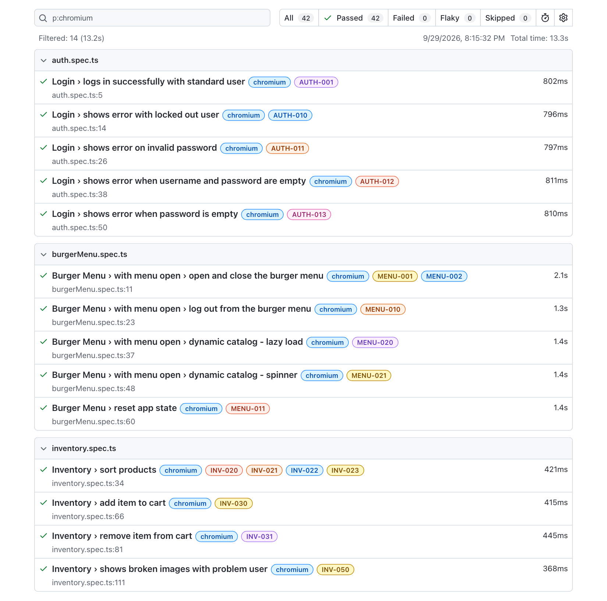

# playwright-saucedemo

[](https://github.com/nowel-yang/playwright-saucedemo/actions/workflows/playwright.yml)
[](https://nowel-yang.github.io/playwright-saucedemo/)

End-to-end tests for [SauceDemo](https://www.saucedemo.com), a demo online shop,
written with Playwright and TypeScript. They run in Chromium, Firefox and WebKit.

## Tech stack

- **[Playwright Test](https://playwright.dev)** with **TypeScript**
- **Page Object Model:** one class per page or component in `pages/`
- **Custom fixtures** that provide page objects and a logged-in start (`fixtures/index.ts`)
- **ESLint** with `eslint-plugin-playwright`
- **Husky** pre-commit hook, and **GitHub Actions** for CI

## What's covered

| Feature     | Test cases                                       | Status        |
| ----------- | ------------------------------------------------ | ------------- |
| Login       | [auth.md](docs/test-cases/auth.md)               | ✅ Automated   |
| Burger menu | [burger-menu.md](docs/test-cases/burger-menu.md) | ✅ Automated   |
| Inventory   | [inventory.md](docs/test-cases/inventory.md)     | 🚧 In progress |
| Cart        | _planned_                                        | 📋 Planned     |
| Checkout    | _planned_                                        | 📋 Planned     |

The [test plan](docs/test-plan.md) describes scope, approach, test users and risks.
The [docs README](docs/README.md) explains how the test docs are organized.

### Test report

The [latest HTML report](https://nowel-yang.github.io/playwright-saucedemo/) is published from CI on every push to
`main`. Every test is tagged with its test case ID, so the report maps straight back to
the docs. (Chromium run shown below; the suite also runs in Firefox and WebKit.)

[](https://nowel-yang.github.io/playwright-saucedemo/)

## Practices

- **Web-first assertions only.** Assertions wait for the page (`await expect(locator).toHaveText(...)`)
  instead of reading a value once or using fixed waits. ESLint enforces this.
- **Tests are traceable to test cases.** Every test is tagged with its case ID, such as
  `@INV-030`, so a case can be run on its own and found in the HTML report.
- **Two gates.** The pre-commit hook runs lint and the full suite before every commit,
  and GitHub Actions runs the suite again on every push and pull request.
- **Flaky tests are fixed, not retried away.** Retries are off locally so flakiness
  shows up straight away. CI allows 2 retries, and tests marked "flaky" there get
  investigated.
- **Isolated tests.** Each test gets a fresh browser context, and cart state is set
  up directly in `localStorage` so a test only fails for what it is testing.
- **Log in once per run.** A setup project (`tests/auth.setup.ts`) logs in as
  `standard_user` and saves the session, and the browser projects start from it
  with `storageState`. Login tests and tests for other users start logged out.
- **Page objects come from fixtures.** Every page object has a fixture in
  `fixtures/index.ts`, so tests ask for `{ inventoryPage }` instead of calling
  `new InventoryPage(page)`. Plain fixtures only create the object. Fixtures such
  as `authenticatedInventoryPage` add setup on top, like opening the inventory
  page with the saved session.

## Getting started

Requires Node.js (LTS).

```bash
git clone https://github.com/nowel-yang/playwright-saucedemo.git
cd playwright-saucedemo
npm ci                    # install dependencies (also sets up the pre-commit hook)
npx playwright install    # download the browsers
npm test                  # run all tests in all browsers
```

## Useful commands

```bash
npm run test:ui           # interactive UI mode
npm run test:headed       # watch the browser while tests run
npm run report            # open the last HTML report
npm run lint              # run ESLint
```

Run one test case, or a whole section, by its tag:

```bash
npx playwright test --grep @INV-030   # one case
npx playwright test --grep @AUTH-01   # every rejected-login case (AUTH-010 to AUTH-019)
```

## Project structure

```text
playwright-saucedemo/
├── .github/workflows/
│   └── playwright.yml        # CI: runs the suite on every push and PR
├── .husky/
│   └── pre-commit            # runs lint + tests before each commit
├── docs/
│   ├── README.md             # how the test docs are organized
│   ├── test-plan.md          # scope, approach, users, risks
│   ├── images/               # screenshots used in this README
│   └── test-cases/           # one file per feature
│       ├── auth.md
│       ├── burger-menu.md
│       └── inventory.md
├── fixtures/
│   └── index.ts              # logged-in page fixtures
├── pages/                    # page objects
│   ├── components/           # parts shared across pages
│   │   └── BurgerMenu.ts
│   ├── InventoryPage.ts
│   └── LoginPage.ts
├── test-data/
│   ├── items.ts              # product names and IDs
│   └── users.ts              # SauceDemo users and passwords
├── tests/
│   ├── auth.setup.ts         # logs in once and saves the session
│   ├── auth.spec.ts
│   ├── burgerMenu.spec.ts
│   └── inventory.spec.ts
├── eslint.config.mjs         # lint rules (Playwright plugin)
├── playwright.config.ts      # browsers, retries, workers, base URL
└── package.json
```

## About

Built by Nowel Yang as a QA automation portfolio project.
[LinkedIn](https://www.linkedin.com/in/nowelyang)
